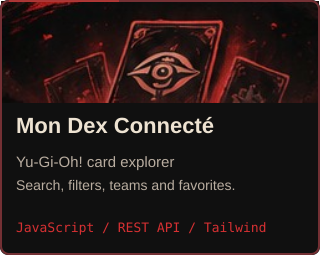
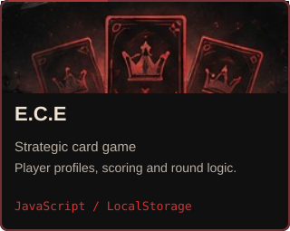
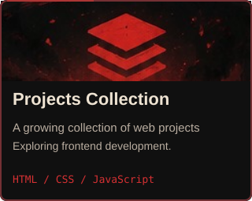

<table>
<tr>
<td width="33%" align="center"></td>
<td width="33%" align="center"></td>
<td width="33%" align="center"></td>
</tr>
</table>

[Explore my repositories](https://github.com/MohaAarab?tab=repositories) · [View contribution activity](https://github.com/MohaAarab#user-activity-overview)

Advanced JavaScript · Asynchronous programming · REST APIs  
Responsive UI · Project architecture · Git workflows

[Email](mailto:hello@aarabautomation.com) · [GitHub](https://github.com/MohaAarab)

<!-- Add your verified LinkedIn profile URL here. -->

