# `MOHAMED AARAB` — Developer in Progress

<div align="center">


### `user@workstation:~$ ./load_profile.sh`


**Software Engineering Student @ YouCode | Automation Specialist**

`Learning by building. Automating what matters.`

```text
┌──────────────────────────────────────────────────────────┐
│ TERMINAL — /home/mohamed                                 │
├──────────────────────────────────────────────────────────┤
│ $ whoami                                                 │
│ Mohamed aarab                                             │
│                                                          │
│ $ cat mission.txt                                        │
│ Building useful software.                                │
│ Automating repetitive work.                              │
│ Learning by shipping real projects.                      │
│                                                          │
│ $ echo $STATUS                                           │
│ FULL-STACK DEVELOPMENT + AUTOMATION                      │
└──────────────────────────────────────────────────────────┘
```

[](https://github.com/MohaAarab)
[](https://mohamed-aaarab-automation.vercel.app)
[](https://www.linkedin.com/in/mohamed-aaarab-real-estate-automation/)

</div>

---

## `01` / ABOUT_ME

```yaml
name: Mohamed aarab
role:
  - Software Engineering Student @ YouCode
  - Full-Stack Developer in Progress
  - Automation Specialist

interests:
  - JavaScript and Web Development
  - Backend Development and Databases
  - Workflow Automation with n8n
  - APIs and System Integration

philosophy: "Learn by building. Improve by shipping."
location: Morocco
status: "Currently learning and building"
```

> Curious, technical, and focused on building practical solutions. I enjoy connecting APIs, designing workflows, working with databases, and turning ideas into functional projects.

## `02` / TECH_STACK

<div align="center">

| FRONTEND | BACKEND & DATABASES | AUTOMATION & TOOLS |
|:---:|:---:|:---:|
|  |  |  |
|  |  |  |
|  |  |  |
|  |  |  |

</div>

**Currently developing:** JavaScript fundamentals, DOM manipulation, form validation, modular code, database design, SQL queries, and API integration.

## `03` / FEATURED_PROJECTS

<table>
<tr>
<td width="50%" valign="top">

### 🏠 Real Estate WhatsApp Automation

Automated property search and lead interactions using n8n, databases, and messaging APIs.

**Stack:** `n8n` `PostgreSQL` `WhatsApp API`

[Explore projects →](https://github.com/MohaAarab/projects-collection)

</td>
<td width="50%" valign="top">

### 🤖 Telegram Real Estate State Manager

A Telegram-based real-estate workflow using persistent state and database-backed interactions.

**Stack:** `n8n` `Supabase` `Telegram API`

[Explore projects →](https://github.com/MohaAarab/projects-collection)

</td>
</tr>
<tr>
<td width="50%" valign="top">

### 🃏 Yu-Gi-Oh! Interactive Dex

A searchable card encyclopedia built with HTML, Tailwind CSS, and JavaScript.

**Stack:** `JavaScript` `HTML` `Tailwind CSS`

[View my repositories →](https://github.com/MohaAarab?tab=repositories)

</td>
<td width="50%" valign="top">

### ⚙️ More experiments

Small projects, learning exercises, and experiments in web development, automation, and databases.

**Approach:** Build → Test → Improve

[Browse all repositories →](https://github.com/MohaAarab?tab=repositories)

</td>
</tr>
</table>

## `04` / CURRENTLY_EXPLORING

```bash
$ cat ~/learning/roadmap.txt

[+] JavaScript fundamentals and asynchronous code
[+] DOM manipulation and browser APIs
[+] Modular application architecture
[+] SQL and relational database design
[+] Git, branches, commits and pull requests
[>] Backend development and API integration
[>] Building complete projects at YouCode

$ _
```


## `05` / GITHUB_ACTIVITY

<div align="center">





</div>


## `06` / CONNECT

<div align="center">

[](https://github.com/MohaAarab)
[](https://www.linkedin.com/in/mohamed-aaarab-real-estate-automation/)
[](https://mohamed-aaarab-automation.vercel.app)

**`root@workstation:~$`** Thanks for visiting. Let's build something useful.


</div>
